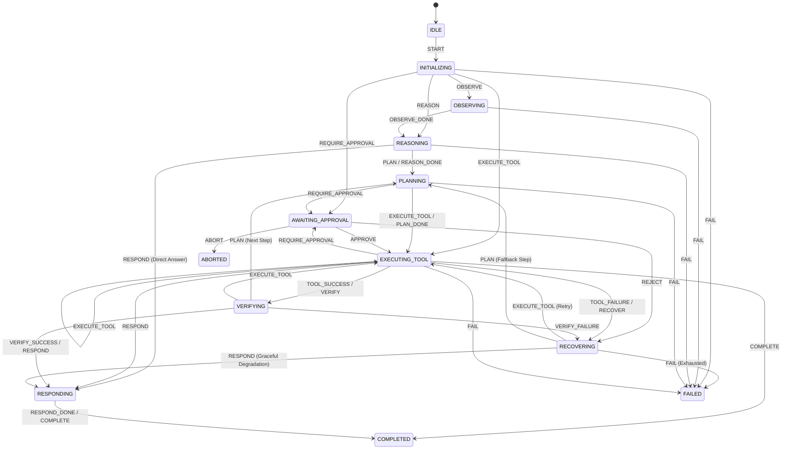
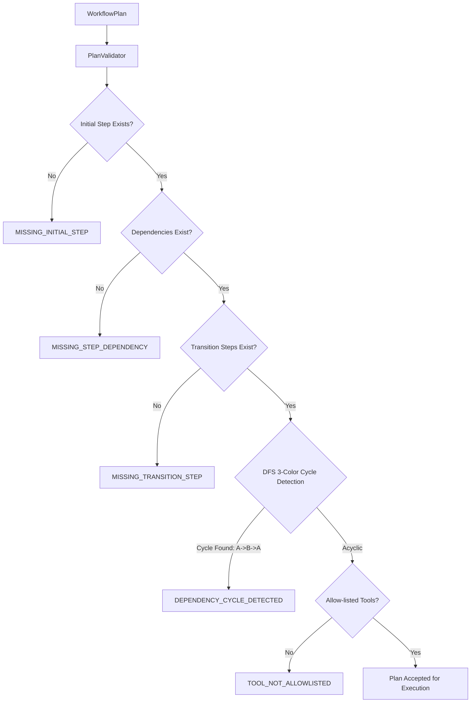
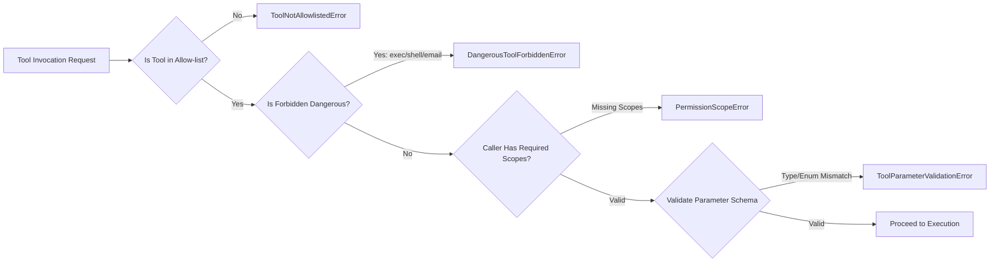
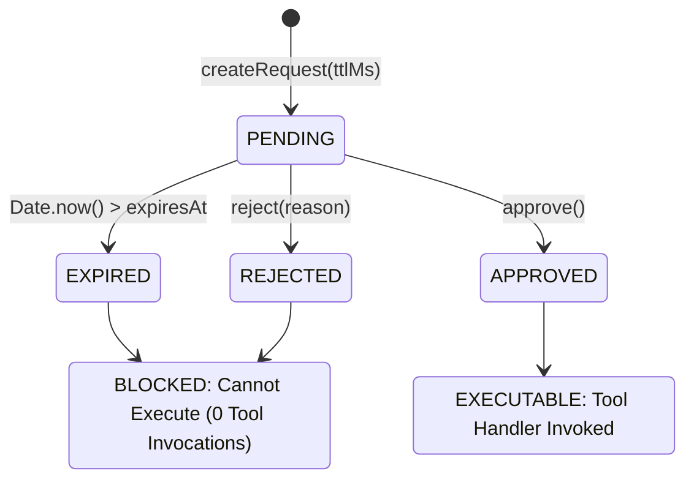
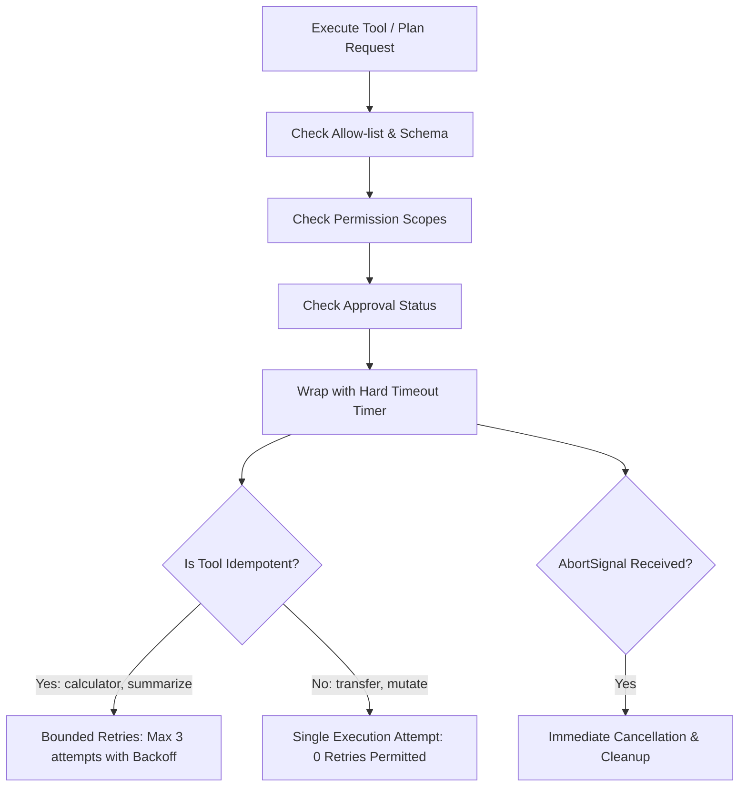

# System Architecture Specification

**Product:** Academia AI Voice Co-Pilot  
**Component:** Agentic Workflow Orchestrator, Validation, Tool Registry, Approvals & Safe Executor  
**Document Version:** 2.0 (Week 2 Milestone)  
**Target Branch:** `team/sde-8-voicebot`  

---

## 1. Architectural Principles

This component implements the intelligence, validation, and safe execution layer of the AI Voice Co-Pilot system adhering to the following design tenets:
1. **Deterministic State Transitions:** All workflow progression is mediated by a formal finite state machine (`StateMachine`) with explicit transition rules and guard predicates.
2. **Pre-execution Plan Validation:** Workflow dependency graphs are strictly validated before execution. Missing dependencies and cycles are detected and rejected upfront.
3. **Controlled & Allow-listed Tool Execution:** Only allow-listed harmless tools run (`calculator`, `summarize_text`). Dangerous tools with unrestricted operating-system access or external sending are strictly forbidden.
4. **Safety by Design & Approval Lifecycles:** Human-in-the-loop approvals (`PENDING` $\to$ `APPROVED` | `REJECTED` | `EXPIRED`) ensure that a rejected or expired action **NEVER** executes.
5. **Safe Execution Safeguards:** Executor enforces per-step timeouts, bounded retries strictly limited to idempotent operations, and mid-flight cancellation via `AbortController`.
6. **Fault Tolerance & Rollback:** Automatic recovery via exponential backoff with jitter for idempotent tasks, fallback routing, and Saga pattern rollback compensations.
7. **Observability & Auditability:** Every state transition, tool invocation, duration, and safety gate decision is recorded into an append-only audit trail.

---

## 2. State Machine Design

### 2.1 States
- `IDLE`: Initial idle state before workflow activation.
- `INITIALIZING`: Ingestion of user voice request and active desktop environment context.
- `OBSERVING`: Capturing visual context (active window, screen OCR, file descriptors).
- `REASONING`: Contextual analysis of user intent and decision formulation.
- `PLANNING`: Task decomposition into ordered execution steps.
- `AWAITING_APPROVAL`: Execution paused pending user confirmation of sensitive/destructive actions.
- `EXECUTING_TOOL`: Controlled invocation of external mock or real tools.
- `VERIFYING`: Validation of tool execution outputs against expected constraints.
- `RESPONDING`: Synthesis and delivery of voice/visual response to the user.
- `COMPLETED`: Terminal state indicating successful workflow termination.
- `FAILED`: Terminal state indicating unrecoverable workflow failure.
- `ABORTED`: Terminal state indicating intentional user or system cancellation.
- `PAUSED`: Execution suspended, preserving snapshot state for subsequent resumption.
- `RECOVERING`: Transient state while executing retries, fallbacks, or compensation actions.

### 2.2 Transition Matrix

---

## 3. Plan Validation & Cycle Detection (`PlanValidator`)

Before any workflow executes, the `PlanValidator` analyzes the static DAG structure:

### 3.1 Cycle Detection Algorithm
A directed graph Depth-First Search (DFS) with 3-state coloring (`UNVISITED`, `VISITING`, `VISITED`) tracks the active recursion stack. If an edge reaches a node marked `VISITING`, a directed cycle is detected and the complete path sequence is returned (e.g. `['step_init', 'step_b', 'step_init']`).

---

## 4. Allow-Listed Tool Registry & Scope Permissions (`ToolRegistry`)

---

## 5. Approval Gate & Lifecycle (`ApprovalManager`, `SafetyGate`)

The safety layer enforces human-in-the-loop authorization with explicit TTL and execution blocks:

### 5.1 Strict Non-Execution Invariant
If an approval is `REJECTED` or `EXPIRED`:
- The orchestrator cancels the step and transitions to `REJECT`.
- The tool executor verifies `assertCanExecute(approvalId)` and immediately aborts.
- **Guarantee:** Tool mock handlers are invoked **0 times**.

---

## 6. Safe Executor Architecture (`SafeExecutor`)

### 6.1 Bounded Retries for Idempotent Calls Only
Operations with side effects must never be blindly retried upon failure. The executor inspects `tool.isIdempotent` and `step.isIdempotent`. If false, retries are skipped completely and the first failure is reported immediately or routed to fallback handlers.
