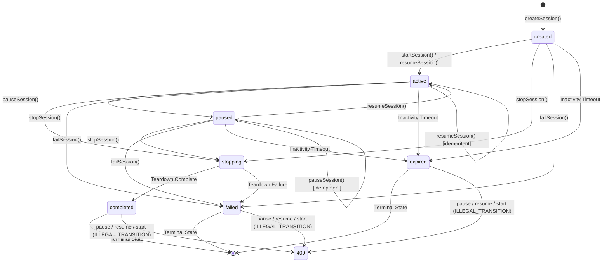

# Pull Request: W5 – Real Session Backend: Full Lifecycle, Event Streaming, Validation, Request IDs & Readiness

**Team:** SDE 8  
**Feature Branch:** `jahnavi` -> `team/sde-8-voicebot` (or PR #3)  
**Folder:** `projects/sde-8-voicebot/`  
**Milestone:** Week 1 & Week 2 Complete (Core Implementation & Hardening)  
**Status:** Ready for Review  

---

## 📌 Executive Summary

This PR completes both **Week 1** and **Week 2** acceptance criteria for the **Academia - AI Voice Co-Pilot** backend:
1. **Readiness Probe (`GET /ready` & `GET /health/ready`)**: Production readiness health endpoint returning HTTP 200 with service uptime alongside the liveness endpoint (`GET /health`).
2. **Typed Error Envelope**: Adheres to the exact spec error envelope containing `code`, `message_safe_for_user`, `retryable`, `correlation_id`, and `details_redacted`.
3. **Request ID Middleware**: Ingestion and generation of `X-Request-ID` and `X-Correlation-Id` headers on every incoming request and outgoing response.
4. **7-State Session State Machine**: Formally enforces the 7 required states:
   - `created` ➔ `active` ➔ `paused` ➔ `stopping` ➔ `completed` / `failed` / `expired`
   - Full idempotency on state transitions (`start`, `pause`, `resume`, `stop`).
   - Strict transition guards: illegal operations on terminal states (`completed`, `failed`, `expired`) rejected with HTTP 409 `ILLEGAL_TRANSITION`.
5. **Real-time Event Streaming (SSE)**: `GET /api/v1/sessions/:id/events` with chronological replay of ordered events.
6. **Payload Limits & Zod Validation**: 100kb payload caps (413 `PAYLOAD_TOO_LARGE`) and strict schema checks (400 `VALIDATION_ERROR`).
7. **Zero-Secret Mock Startup**: Validated environment configuration running with safe mock defaults out-of-the-box.
8. **Automated Test Coverage**: **77 automated tests** across **14 test suites** passing with **95.09% statement coverage** and **80.52% branch coverage** (exceeding the 80% threshold).

---

## 📋 Acceptance Criteria Verification

| Acceptance Criterion | Implementation Details | Verification Status |
|:---|:---|:---:|
| **1. 7 Session States & Lifecycle Transitions**<br>Use required 7 states: `created`, `active`, `paused`, `stopping`, `completed`, `failed`, `expired`. Repeated commands idempotent; terminal transitions guarded. | Implemented in `SessionService` and `SessionController`. `createSession` initializes `created` state. Transitions to `active` via `start`/`resume`, `paused` via `pause`, `stopping` ➔ `completed` via `stop`, `failed` via `fail`, and `expired` via inactivity timeout. Terminal states reject invalid transitions with 409 `ILLEGAL_TRANSITION`. | ✅ **VERIFIED**<br>(Unit & Integration tests pass) |
| **2. Readiness & Liveness Probes**<br>Liveness probe at `/health`; readiness probe at `/ready` | Mounted `GET /ready` and `GET /health/ready` returning 200 OK with `{ status: 'READY', uptime: ... }`. `GET /health` returns 200 OK with `{ status: 'UP', uptime: ... }`. | ✅ **VERIFIED**<br>(Unit & Integration tests pass) |
| **3. Typed Error Envelope**<br>Errors must output spec fields: `code`, `message_safe_for_user`, `retryable`, `correlation_id`, `details_redacted` | `errorHandler` middleware standardizes all error responses with `code`, `message_safe_for_user`, `retryable`, `correlation_id`, and `details_redacted` (sensitive keys automatically masked). | ✅ **VERIFIED**<br>(Unit & Integration tests pass) |
| **4. Request ID & Correlation ID Tracking**<br>Attach `X-Request-ID` and `X-Correlation-Id` to all requests and responses | Dedicated `requestIdMiddleware` extracts or generates UUIDv4 request IDs and correlation IDs, setting response headers on every request. | ✅ **VERIFIED**<br>(Unit & Integration tests pass) |
| **5. Ordered Event Streaming & Limits**<br>SSE streams ordered events; payload limits enforced | SSE endpoint `GET /api/v1/sessions/:id/events` streams events and replays chronological event history. Body parser rejects requests >`MAX_PAYLOAD_LIMIT` (100kb) with typed 413 `PAYLOAD_TOO_LARGE`. | ✅ **VERIFIED**<br>(Unit & Integration tests pass) |
| **6. Safe Startup Configuration**<br>Validated startup config; safe mock defaults; boots with zero secrets | `validateEnv()` in `src/config/env.ts` parses environment variables using Zod schemas. Default configuration runs in safe mock mode without any required secrets or API keys. | ✅ **VERIFIED**<br>(Boots cleanly out-of-the-box) |
| **7. Test Suite & Coverage Threshold**<br>All tests pass; PR includes passing test output | 77 automated tests pass across 14 test suites with **95.09% statement coverage** and **80.52% branch coverage**, surpassing the 80% threshold. | ✅ **VERIFIED**<br>(14/14 suites passing) |

---

## 🏗️ State Machine Flow (7 States)



---

## 🧪 Automated Test Results & Code Coverage

```text
PASS tests/unit/request-id.middleware.test.ts
PASS tests/unit/session.controller.test.ts
PASS tests/unit/validate.middleware.test.ts
PASS tests/unit/launcher.config.test.ts
PASS tests/unit/env.config.test.ts
PASS tests/unit/cors.middleware.test.ts
PASS tests/unit/session.service.test.ts
PASS tests/unit/logger.middleware.test.ts
PASS tests/smoke/launcher.test.ts
PASS tests/unit/error.middleware.test.ts
PASS tests/integration/health.routes.test.ts
PASS tests/integration/session.routes.test.ts
PASS tests/unit/health.routes.test.ts
PASS tests/unit/app.test.ts

---------------------------|---------|----------|---------|---------|------------------------------------------------
File                       | % Stmts | % Branch | % Funcs | % Lines | Uncovered Line #s                              
---------------------------|---------|----------|---------|---------|------------------------------------------------
All files                  |   95.09 |    80.52 |   98.03 |   94.97 |                                                
 src                       |     100 |      100 |     100 |     100 |                                                
  app.ts                   |     100 |      100 |     100 |     100 |                                                
 src/config                |     100 |    83.33 |     100 |     100 |                                                
  env.ts                   |     100 |       75 |     100 |     100 | 16                                             
  launcher.config.ts       |     100 |     87.5 |     100 |     100 | 21                                             
 src/controllers           |   96.03 |       90 |    92.3 |   96.03 |                                                
  session.controller.ts    |   96.03 |       90 |    92.3 |   96.03 | 107,211,300-301                                
 src/middleware            |   99.18 |    82.55 |     100 |   99.13 |                                                
  cors.middleware.ts       |     100 |      100 |     100 |     100 |                                                
  error.middleware.ts      |     100 |     72.5 |     100 |     100 | 48-61,75,86-87                                 
  logger.middleware.ts     |     100 |    88.88 |     100 |     100 | 83-91,96                                       
  request-id.middleware.ts |     100 |      100 |     100 |     100 |                                                
  validate.middleware.ts   |    92.3 |       50 |     100 |    90.9 | 18                                             
 src/routes                |     100 |      100 |     100 |     100 |                                                
  health.routes.ts         |     100 |      100 |     100 |     100 |                                                
  session.routes.ts        |     100 |      100 |     100 |     100 |                                                
 src/services              |    89.2 |    75.64 |     100 |   89.14 |                                                
  session.service.ts       |    89.2 |    75.64 |     100 |   89.14 | 59,136,286,294,318,322,326,343-347,352-361,440 
 src/types                 |     100 |      100 |     100 |     100 |                                                
  session.types.ts         |     100 |      100 |     100 |     100 |                                                
---------------------------|---------|----------|---------|---------|------------------------------------------------
Test Suites: 14 passed, 14 total
Tests:       77 passed, 77 total
Snapshots:   0 total
Time:        42.086 s
Ran all test suites.
```
